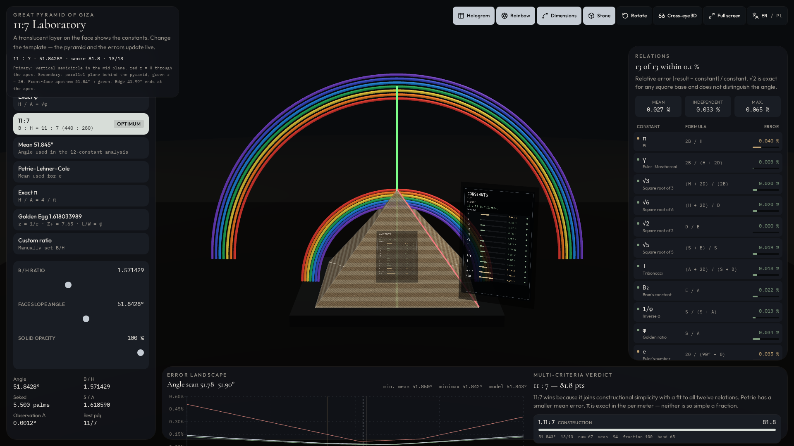
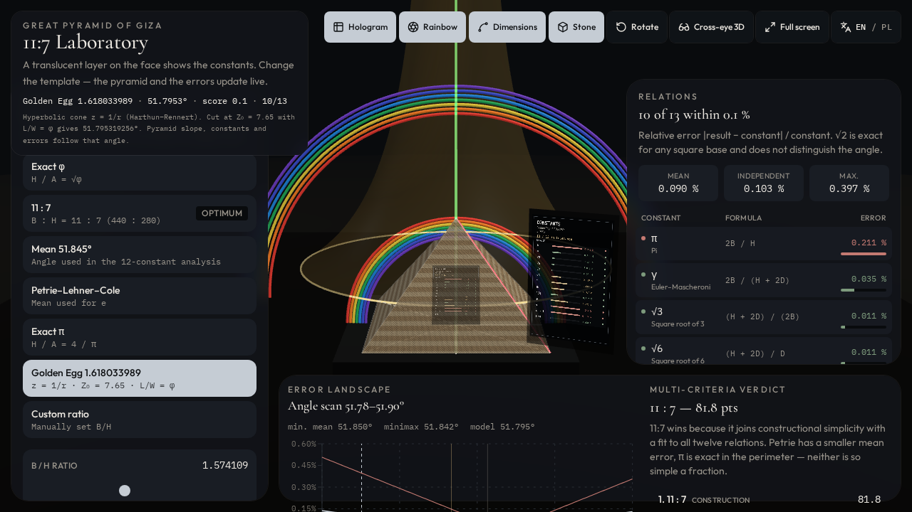

# Wielka Piramida 11:7 — laboratorium stałych matematycznych

> **Jedna proporcja, żywy model 3D, tabela błędów stałych, oznaczona korespondencja tęczowa i Golden Φ Egg z cięcia z = 1/r.**

[English version](README.md) · [Matematyka](docs/MATHEMATICS.md) · [Golden Egg](docs/GOLDEN-EGG.md) · [Korespondencja optyczna](docs/OPTICAL-CORRESPONDENCE.md) · [Poprzednik: model Fusion](https://github.com/MichaelZP/great-pyramid-11-7)

**Otwórz w przeglądarce (bez instalacji):** [michaelzp.github.io/great-pyramid-11-7-lab](https://michaelzp.github.io/great-pyramid-11-7-lab/)



To repozytorium to **laboratorium WWW (v2)** badania piramidy 11:7. Generator Autodesk Fusion pozostaje w osobnym projekcie: [MichaelZP/great-pyramid-11-7](https://github.com/MichaelZP/great-pyramid-11-7).

Scena to w pełni parametryczna piramida kwadratowa z tradycyjnych wymiarów **440 × 280 łokci królewskich**. W skali **1:3200**, przy przyjętym łokciu **523,8 mm**, bok podstawy wynosi **72,0225 mm**, a dla 11:7 wysokość **45,8325 mm**.

Laboratorium rozdziela cztery warstwy:

1. **Dokładna geometria parametryczna** — bryła z 440, 280, łokcia i skali.
2. **Cele porównawcze** — wyrażenia bezwymiarowe z bieżącego kąta ściany, tolerancja względna **0,1%**.
3. **Schemat korespondencji optycznej** — nachylenie krawędzi ~42° i apotema 51,842773° obok pasm tęczy pierwotnej i wtórnej.
4. **Golden Φ Egg (v2)** — stożek hiperboliczny `z = 1/r` cięty przy `Z₀ = 7,65` tak, że `L/W = φ`, kąt płaszczyzny **αp = 51,795319256°**. Przekrój jest owalem, nie elipsą. Zwykła scena jaja jest ilustracją; wybrana lekcja L/W przedstawia obliczony przekrój.

Wynik służy geometrii, wizualizacji i dyskusji krytycznej — nie jest dowodem starożytnego kodu optycznego ani matematycznego.

**Gotowa geometria do druku** (poprzednik Fusion): [Thingiverse, thing:6944382](https://www.thingiverse.com/thing:6944382).

## Dlaczego ta bryła jest wyjątkowa

Bardzo prosta geometria oparta na liczbach całkowitych daje niezwykle bogatą rodzinę bliskich zależności liczbowych. Schemat 440:280 daje:

- dokładny stosunek podstawy do wysokości **11:7**;
- stosunek połowy obwodu do wysokości **22:7**, czyli klasyczne wymierne przybliżenie π;
- nachylenie ściany **51,842773°**;
- nachylenie krawędzi **41,985759°**;
- zwarty zestaw długości pochodnych, które można porównać z π, φ, e i innymi stałymi.

Golden Φ Egg to **osobny** model: nie korzysta z zaokrąglonego stożka 51,84°. Przy `Z₀ = 7,65` numeryczne rozwiązanie równania `L/W = φ` dla `z = 1/r` daje **51,795319256°**. Ten kąt wyznacza B/H, wysokość i błędy wszystkich stałych. Stożek 51,84° pozostaje wyłącznie modelem porównawczym.

## Wymiary kanoniczne (11:7)

| Wielkość | Wyrażenie | Wynik |
|---|---|---:|
| Przyjęty łokieć królewski | `RoyalCubit` | 523,8 mm |
| Podstawa / wysokość | `440 / 280` | 11 : 7 |
| Skala modelu | `ModelScale` | 1 : 3200 |
| Bok podstawy | `440 × 523,8 mm ÷ 3200` | 72,0225 mm |
| Wysokość pionowa | `280 × 523,8 mm ÷ 3200` | 45,8325 mm |
| Apotema ściany | `√(H² + A²)` | 58,287462 mm |
| Krawędź boczna | `√(H² + B²/2)` | 68,514512 mm |
| Nachylenie ściany | `atan(H / A)` | 51,842773° |
| Nachylenie krawędzi | `atan(H / (D/2))` | 41,985759° |

## Porównania stałych (11:7, tolerancja 0,1%)

Każdy wiersz wynika z bieżącej bryły. Przy `MathTolerance = 0,001` bryła 11:7 utrzymuje klasyczne dwanaście w zakresie 0,1%; po geometrycznym obliczeniu owalu trzynasty wiersz L/W wypada tuż poza (~0,106% względem φ). To 12 z 13 — nie 13 z 13.

| Symbol | Formuła | Cel |
|---|---|---|
| π | `2B / H` | π |
| γ | `2B / (H + 2D)` | Euler–Mascheroni |
| √3 | `(H + 2D) / (2B)` | √3 |
| √6 | `(H + 2D) / D` | √6 |
| √2 | `D / B` | √2 (podstawa kwadratowa — niezależne od kąta nachylenia) |
| √5 | `(S + B) / S` | √5 |
| T | `(A + 2D) / (S + B)` | tribonacci |
| B₂ | `E / A` | stała Bruna |
| 1/φ | `S / (S + A)` | 1/φ |
| φ | `S / A` | φ |
| e | `2θ / (90° − θ)` | e |
| e − 1 | `e_model − 1` | e − 1 |
| L/W | długość/szerokość jaja dla `z = 1/r` przy `Z₀ = 7,65` | φ przy 51,795319256° |

To są **wzory porównawcze wybrane dla tego studium**, a nie dwanaście (ani trzynaście) niezależnych więzów konstrukcyjnych. Pełne wzory: [docs/MATHEMATICS.md](docs/MATHEMATICS.md).

## Korespondencja optyczna

- **Tęcza pierwotna** — pionowy półokrąg w płaszczyźnie środkowej XZ, z centrum na osi piramidy; promień zewnętrznego pasma czerwieni = wysokość piramidy, więc rzeczywista krawędź boczna kończy się w wierzchołku.
- **Tęcza wtórna** — równoległa pionowa płaszczyzna za bryłą, odwrócona kolejność kolorów; apotema ściany jest przedłużona i spotyka pasmo zieleni przy promieniu `2H`.
- Nachylenie ściany **51,842773°** wobec zieleni wtórnej ≈ **51,83°** (różnica **0,012773°**).

Wyświetlane promienie są schematyczne, a nie rzeczywiste odległości atmosferyczne. Zobacz [docs/OPTICAL-CORRESPONDENCE.md](docs/OPTICAL-CORRESPONDENCE.md).

## Golden Φ Egg



Wybór **Golden Egg 1.618033989** ustawia piramidę na **51,795319256°**. Za bryłą na płaszczyźnie podłoża stoi półprzezroczysty stożek hiperboliczny (`r ∝ 1/z`). Zwykły stożek i obrócone jajo są ilustracyjne i używają innych parametrów kadrowania niż sekcja numeryczna. Wybierz **L/W**, aby obejrzeć rzeczywisty zamknięty owal przy `Z₀=7,65`, z jego długością i maksymalną szerokością. Przy tym presecie silnik zgłasza 10 z 13 relacji w zakresie 0,1% oraz maksymalny błąd względny ok. 0,4% (około 4× zadeklarowanej tolerancji); 11:7 pozostaje modelem konstrukcyjnym. Szczegóły: [docs/GOLDEN-EGG.md](docs/GOLDEN-EGG.md).

## Modele w laboratorium

| Model | Definicja | Kąt ściany |
|---|---|---:|
| Dokładne φ | `H / A = √φ` | 51,827292° |
| **11 : 7** | `B : H = 11 : 7` (440 : 280) | **51,842773°** |
| Średnia 51,845° | kąt analizy stałych | 51,845° |
| Petrie–Lehner–Cole | średnia użyta dla *e* | 51,8504° |
| Dokładne π | `H / A = 4 / π` | 51,853974° |
| Golden Φ Egg | `L/W = φ`; `z = 1/r`; `Z₀ = 7,65` | **51,795319256°** |
| Własny stosunek | `B/H` lub kąt użytkownika | edytowalny |

Wybrane wagi (wspólne ze skoroszytem): błąd ważony 0,35, bliskość kąta odniesienia 0,25, preferencja 11/7 0,25, odporność w paśmie 0,15. Aplikacja ocenia 13 wierszy, arkusze 12 i inne kryterium ułamka. Wagi nie dowodzą niezależności ani intencji budowniczych. **11:7 jest preferowanym presetem konstrukcyjnym**; Golden Egg to trop geometryczny, nie zamiennik konstrukcji. Dla predefiniowanego Golden Egg silnik laboratorium zgłasza **10 z 13** relacji w 0,1%, średni błąd względny ≈ 0,090%, maksimum ≈ 0,397% (~0,4%). Dla 11:7 klasyczne dwanaście pozostaje w 0,1%; trzynasty wiersz L/W wypada tuż poza (~0,106%) po obliczeniu geometrii owalu — to 12 z 13, nie 13 z 13.

## Uruchomienie w przeglądarce

Sam GitHub **nie uruchamia** aplikacji Vite z drzewa źródłowego. Zbudowana strona stoi na **GitHub Pages** — laboratorium otwiera się bez pobierania kodu:

**https://michaelzp.github.io/great-pyramid-11-7-lab/**

## Uruchomienie lokalne

Wymagany [Node.js](https://nodejs.org/) **22 lub nowszy**.

```bash
git clone https://github.com/MichaelZP/great-pyramid-11-7-lab.git
cd great-pyramid-11-7-lab
npm install
npm run dev
```

Otwórz adres podany przez Vite (port **8080**).

## Źródłowe skoroszyty

- [`data/Great_Pyramid_11_7_Mathematical_Constants_Lab.xlsx`](data/Great_Pyramid_11_7_Mathematical_Constants_Lab.xlsx)
- [`data/Piramida_11_7_laboratorium_stalych.xlsx`](data/Piramida_11_7_laboratorium_stalych.xlsx)

## Autorstwo i podziękowania

**Koncepcja, synteza matematyczna i autorstwo:** Michał Przybylski — [prylski.dev](https://prylski.dev/).

Laboratorium WWW kontynuuje model Fusion [great-pyramid-11-7](https://github.com/MichaelZP/great-pyramid-11-7).

Szczególne podziękowania dla **Philipa Lavena** (korespondencja z 1 kwietnia 2017: referencja tęczy wtórnej przy ~525 nm, ok. 51,83°). Podziękowanie **nie** oznacza poparcia hipotez historycznych.

Dalsze podziękowania: **Rich Jarvis** (związek kątów piramidy i tęczy) oraz **[Alan Green](https://tobeornottobe.org/biography/)** (materiał o stałych jako punkt wyjścia interpretacyjny).

Stożek Harthuna–Rennerta `z = 1/r` oraz rozwiązanie `Z₀ = 7,65`, `L/W = φ` są użyte zgodnie ze skoroszytami projektu. Odpowiedzialność za implementację spoczywa na autorze.

## Zakres i ostrożna interpretacja

To model matematyczno-wizualny, nie rekonstrukcja geodezyjna. Tolerancja 0,1% nie jest dowodem intencji. Promienie tęcz w scenie są schematyczne. Bliskość liczbowa nie ustanawia przyczyny historycznej.

## Status

Wersja **2.0.0**. Copyright © 2026 Michał Przybylski. Udostępniono na [licencji MIT](LICENSE).
