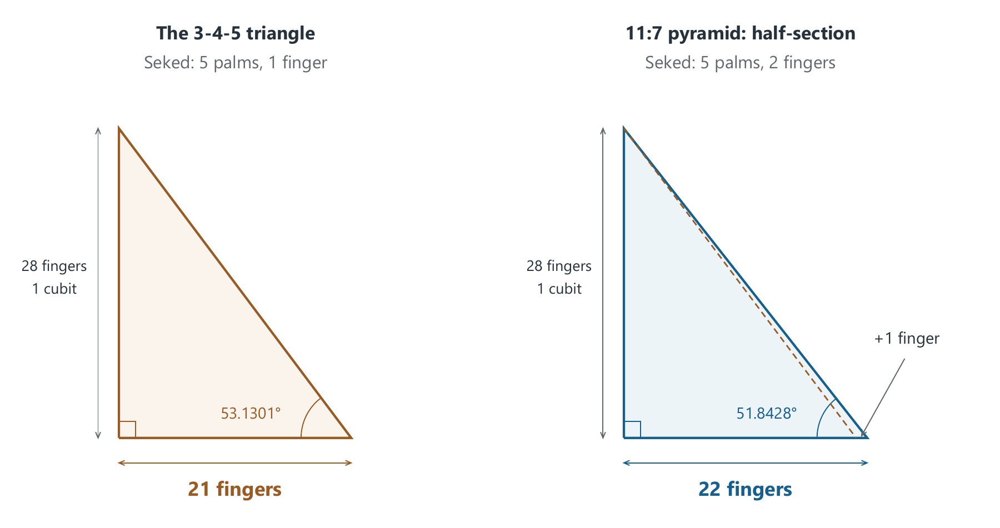

# A Finger's Breadth of Difference

*The 3-4-5 triangle, the Egyptian seked, and the geometry of the 11:7 pyramid*

Take a sheet of paper and draw a triangle. One side is three units long, another four, and the third five. It is a familiar shape that many of us remember from school. Yet looking at it from a slightly different angle is enough to begin a journey from simple arithmetic to the Egyptian pyramids, the number π, and the golden ratio.

What fascinates me most about this journey is that every step can be checked. Draw a line. Measure an angle. Divide two numbers. Watch a solid change shape. Gradually, individual operations begin to form a picture that draws you back. This is the curiosity with which I explore the geometry of the 11:7 pyramid.

I invite you into that world through a very small doorway: a difference of one finger's breadth.

Let us begin with the triangle. Its special property fits into a single equation:

$$
3^2+4^2=5^2.
$$

Nine plus sixteen equals twenty-five. The angle between the sides of lengths 3 and 4 is therefore a right angle. We can enlarge every side tenfold or halve them all, and the angle stays the same. The proportions preserve the shape regardless of size. This lets us transfer a drawing from paper to a floor, a building site, or a three-dimensional model.

You can try it with a cord divided into twelve equal intervals. Join it into a loop and pull it taut so that its three sides span 3, 4, and 5 intervals. The result is a right triangle. In practice, accuracy depends on equal divisions and a taut cord, but the underlying geometric principle is exact.

At this point, a familiar story often appears: Egyptian surveyors restoring field boundaries after the Nile floods. It is an evocative image of ropes, stakes, and people setting out angles on the ground. We should know, however, that the use of a 3-4-5 cord for this purpose is less securely documented than popular accounts suggest. Historians point to the lack of direct evidence for that specific practice. A method's effectiveness does not, by itself, establish its history. [Eli Maor, discussion of Egyptian knowledge of the Pythagorean theorem](https://assets.press.princeton.edu/chapters/s9309.pdf).

There is, however, a source that brings us closer to the pyramids: the Rhind Mathematical Papyrus. Problems 57 and 58 describe a pyramid with a base side of 140 cubits and a slope expressed as five palms and one finger. The calculated height is 93 and one-third cubits. The problems work from dimensions to slope and back again. This is a record of a specific calculation. The surviving papyrus is later than the Great Pyramid, so we cannot treat it as instructions left by that monument's designer. [Translation of the Rhind Mathematical Papyrus, problems 57-58](https://upload.wikimedia.org/wikipedia/commons/7/7b/The_Rhind_Mathematical_Papyrus,_Volume_I.pdf#page=113).

To understand the calculation, put the protractor aside for a moment. Imagine a sloping wall. As we move upward by a given height, we measure how far its surface retreats horizontally. The greater the retreat for the same rise, the gentler the slope.

The Egyptian seked expressed precisely this horizontal setback for one cubit of vertical rise. A royal cubit was divided into seven palms, each palm into four fingers: twenty-eight fingers altogether. Here, a "finger" is the name of a unit of length. What matters in this comparison is its place within that system, so we need not assign it a single absolute length in millimetres. Gay Robins and Charles Shute are among the scholars who have examined the seked in architectural analysis. [Robins and Shute, *Mathematical bases of ancient Egyptian architecture and graphic art*](https://www.sciencedirect.com/science/article/pii/0315086085900023).

Now orient our triangle with the side of length 4 vertical and the side of length 3 horizontal. Enlarge it sevenfold. The height becomes 28, the horizontal leg 21, and the hypotenuse 35. If the units are fingers, the height is exactly one cubit and the setback is five palms and one finger. Simply multiplying by seven has connected the schoolroom triangle to an Egyptian measure of slope.

Let us make one move. Keep the height at 28, but extend the horizontal leg from 21 to 22. The lower point shifts by a finger's breadth. The triangle becomes a little wider, and its hypotenuse takes on a gentler slope.

*A comparison of geometric models. Both drawings use the same scale; the dashed line on the right shows the previous slope.*

Imagine that the second triangle represents half of a vertical cross-section through a pyramid: from the apex, through the centre of the base, to the midpoint of one base side. The length 22 is half the width of the cross-section. Its full width is therefore 44, while the height remains 28. Dividing both numbers by four gives:

$$
44:28=11:7.
$$

We have reached the proportions of my model. A one-finger change in the seked has taken us from the 3-4-5 triangle to the geometry of the 11:7 pyramid. This is an exact mathematical construction. We have found a way to connect two models; whether an ancient designer actually followed this procedure remains an open question.

It is worth pausing to consider what that small movement means. The extra finger applies to every cubit of height. If we compare two models sharing a height of 280 cubits, their half-base widths are 210 and 220 cubits. Their full base sides are 420 and 440. The difference grows to twenty cubits. A small change in proportion, repeated over a great height, has a large effect. We are comparing two geometric possibilities at the same height, rather than the actual dimensions of two monuments.

We can now return to degrees. With the side of length 4 vertical and the side of length 3 horizontal, the triangle's base angle is approximately 53.1301°. The corresponding angle in the 11:7 model is approximately 51.8428°. The difference is about 1.2873°. Both values are easy to reproduce on a calculator, but after our detour through the seked they mean more than numbers alone. We can picture the movement that separates them.

A similar comparison already appears in the literature. Writing about the control of pyramid shape, Bonnie M. Sampsell points out a one-finger difference between the sekeds attributed to the Great Pyramid and the Pyramid of Khafre. This route has earlier guides. For me, being able to retrace their steps is part of the pleasure of learning. [Sampsell, *Control of Pyramid Shape*](https://www.catchpenny.org/control.html).

Then a circle enters the picture.

Let the side of our model's square base be 11 units and its height 7. The base perimeter is 44. Beside it, draw a circle whose radius equals the pyramid's height: 7. Its circumference is 14π, or approximately 43.9823. The two lengths are very close.

The entire relationship comes down to a familiar fraction:

$$
\frac{22}{7}=3.142857\ldots,\qquad
\pi=3.141592\ldots
$$

The relative error is about 0.04025%. To make that tangible, if the square's perimeter were exactly one metre, the circle's circumference would be shorter by approximately 0.40 millimetres. At that scale, the difference is difficult to see in an ordinary drawing, although the calculation reveals it unambiguously.

It is easy to feel a spark of excitement here. We began with three small numbers. Then we moved a point by one finger, constructed a pyramid cross-section, and found a close encounter between a square and a circle. It invites another question: what other proportions follow from this same shape?

Consider the line running up the middle of a face, from its bottom edge to the apex. This is the face apothem, or slant height of the triangular face. In our cross-section it is the hypotenuse of a right triangle whose legs are 5.5 and 7. We can calculate its length using the very theorem with which our journey began.

Dividing the face apothem by half the base side gives:

$$
\frac{\sqrt{5.5^2+7^2}}{5.5}
=\frac{\sqrt{317}}{11}
\approx1.618590.
$$

The golden ratio, denoted by φ, is approximately 1.618034. It describes a division of a line segment in which the whole is to the larger part as the larger part is to the smaller. The difference between it and our result is about 0.03438% of φ. Once again, we are very close.

That closeness becomes more striking when we look at neighbouring values. With a setback of 21 fingers, the ratio of face apothem to half-base is 5/3, or approximately 1.666667. At 22 fingers, we obtain 1.618590. At 23 fingers, the result falls to about 1.575450. We can follow how a change in one parameter shifts the whole set of proportions. In this small comparison, 22 fingers is particularly interesting.

We should remember that π and φ appear in two calculations performed on the same solid. Its shape has already been fixed by the ratio of base side to height. The apothem's length follows automatically. The two numerical similarities are therefore related; they cannot be treated as two independent pieces of evidence for the builders' intentions. Robins and Shute discussed these relationships and the problem of their historical interpretation in a paper published in 1990. [Robins and Shute, *Irrational numbers and pyramids*](https://www.hallofmaat.com/numerology/irrational-numbers-and-pyramids/).

This is why being able to rotate a model and change its proportions is so rewarding. I can watch a result take shape instead of looking only at its final value. I can see which segment I am comparing with which. I distinguish the pyramid's vertical height, the slant height of its face, and the edge running down to a corner of its base. Each line has a different meaning. Moving one point can reveal more than a long list of numbers without a drawing.

My Pyramid 11:7 project provides a way to explore in this manner. Bringing geometry and calculation together lets me return to questions and test further ideas. The moments when a result comes close to an expectation without matching it exactly are especially valuable. Then it is worth magnifying the difference, checking the formula, and establishing precisely what has been compared. This part of working with the model gives me a reason to keep exploring it.

We need not settle the entire history at once. We can ask what could be constructed using simple measures, what the surviving texts tell us, and how well a model agrees with measurements of a monument. These are different questions. A drawing can demonstrate that a construction is possible; a papyrus can attest knowledge of a calculation; a measurement can test a model's fit. Bringing such evidence together allows us to speak cautiously about ancient practice.

In her study of mathematics in Egyptian architecture, Corinna Rossi draws attention to the risk of attributing our own ways of thinking about numbers to ancient builders. That is worth keeping in mind, especially when the geometry delights us. We can describe our own discovery of a relationship precisely, even when we cannot know the thoughts of someone choosing a wall's slope thousands of years ago. [Rossi, *Architecture and Mathematics in Ancient Egypt*](https://assets.cambridge.org/97805218/29540/excerpt/9780521829540_excerpt.htm).

Let us look at the drawing once more. Mark a vertical line 28 centimetres long, then draw a horizontal line 21 centimetres long from its lower end. Join their other ends. Next, extend the base to 22 centimetres and draw the second sloping line. Centimetres stand in for the ancient units here; the proportions stay the same. Before us are two slopes and a very narrow region between them.

Within that region lies the journey we have followed: from 3-4-5 to 11:7, from line segments to a solid, from a practical measure to close encounters with π and φ. We can continue by changing the setback to 23, 24, or 20 and seeing what happens. Every move offers another comparison, and every comparison helps us understand the same shape a little better.

I still want to linger over this drawing. Add another line, turn the model, return to a source. Sometimes a finger's breadth is enough to make a familiar triangle start asking questions again.

---

Project concept: **Michał Przybylski - [prylski.dev](https://prylski.dev/)**. Model and calculations: [Pyramid 11:7 - GitHub](https://github.com/MichaelZP/great-pyramid-11-7-lab). Supplementary educational model: [GeoGebra](https://www.geogebra.org/m/rz4avuw8).
