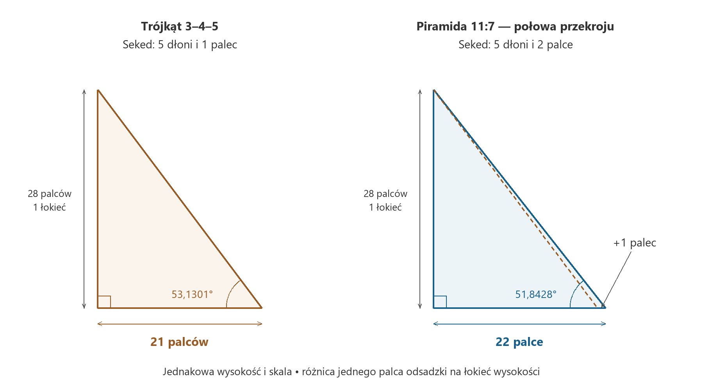

# Różnica szerokości jednego palca

*Trójkąt 3–4–5, egipski seked i geometria piramidy 11:7*

Weźmy kartkę i narysujmy trójkąt. Jeden bok ma długość trzech jednostek, drugi czterech, trzeci pięciu. To znajomy kształt, który wielu z nas pamięta ze szkoły. A jednak wystarczy przyjrzeć mu się z nieco innej strony, żeby rozpocząć podróż od prostego rachunku do egipskich piramid, liczby π i złotej proporcji.

W tej podróży najbardziej fascynuje mnie to, że każdy krok można sprawdzić. Narysować odcinek. Zmierzyć kąt. Podzielić dwie liczby. Zobaczyć, jak zmienia się bryła. Z czasem pojedyncze działania zaczynają układać się w obraz, do którego chce się wracać. Właśnie z takim zainteresowaniem przyglądam się geometrii piramidy 11:7.

Zapraszam do wejścia w ten świat przez bardzo małe drzwi: różnicę szerokości jednego palca.

Zacznijmy od trójkąta. Jego szczególna własność mieści się w jednym równaniu:

$$
3^2+4^2=5^2.
$$

Dziewięć i szesnaście daje dwadzieścia pięć. Dlatego kąt między bokami długości 3 i 4 jest prosty. Możemy powiększyć wszystkie boki dziesięciokrotnie albo zmniejszyć je o połowę — kąt się nie zmieni. Proporcja zachowuje kształt niezależnie od rozmiaru. Ta własność pozwala przenieść rysunek z kartki na podłogę, plac budowy czy model przestrzenny.

Można ją sprawdzić sznurkiem podzielonym na dwanaście równych odcinków. Po zamknięciu go w pętlę i napięciu tak, aby trzy boki obejmowały 3, 4 i 5 odcinków, otrzymamy trójkąt prostokątny. W praktyce dokładność zależy od równych podziałów i napięcia sznurka, ale zasada geometryczna jest ścisła.

W tym miejscu często pojawia się opowieść o egipskich mierniczych odtwarzających granice pól po wylewach Nilu. Obraz jest sugestywny: sznur, kołki i ludzie wyznaczający kąty na ziemi. Powinniśmy jednak wiedzieć, że używanie właśnie sznura 3–4–5 do tego celu nie jest potwierdzone równie dobrze, jak sugerują popularne opisy. Historycy zwracają uwagę na brak bezpośrednich świadectw takiej praktyki. Sama skuteczność metody nie ustala jeszcze jej historii. [Eli Maor, omówienie egipskiej znajomości twierdzenia Pitagorasa](https://assets.press.princeton.edu/chapters/s9309.pdf).

Mamy natomiast źródło, które prowadzi nas bliżej piramid: Papirus Rhinda. W zadaniach 57 i 58 pojawia się piramida o boku podstawy 140 łokci oraz nachyleniu opisanym jako pięć dłoni i jeden palec. Obliczana wysokość wynosi 93 i jedną trzecią łokcia. Zadania pozwalają przechodzić od wymiarów do nachylenia i odwrotnie. To zapis konkretnego rachunku. Zachowany papirus jest późniejszy od Wielkiej Piramidy, więc nie możemy traktować go jak instrukcji pozostawionej przez jej projektanta. [Przekład Papirusu Rhinda, zadania 57–58](https://upload.wikimedia.org/wikipedia/commons/7/7b/The_Rhind_Mathematical_Papyrus,_Volume_I.pdf#page=113).

Żeby zrozumieć ten rachunek, trzeba na chwilę odłożyć kątomierz. Wyobraźmy sobie pochyloną ścianę. Wchodzimy o określoną wysokość i sprawdzamy, o ile jej powierzchnia cofnęła się w poziomie. Im większe cofnięcie przy tym samym wzniesieniu, tym łagodniejsze nachylenie.

Egipski seked wyrażał właśnie taką poziomą odsadzkę na jeden łokieć wysokości. Łokieć królewski dzielił się na siedem dłoni, każda dłoń na cztery palce. Daje to dwadzieścia osiem palców. „Palec” jest tutaj nazwą jednostki miary. W rozważaniu liczy się jej miejsce w tym podziale, więc nie musimy przypisywać jej jednej bezwzględnej długości w milimetrach. Zastosowanie sekedu w analizie architektury opisali między innymi Gay Robins i Charles Shute. [Robins i Shute, *Mathematical bases of ancient Egyptian architecture and graphic art*](https://www.sciencedirect.com/science/article/pii/0315086085900023).

Teraz ustawmy nasz trójkąt tak, aby bok długości 4 był pionowy, a bok długości 3 poziomy. Powiększmy go siedmiokrotnie. Otrzymamy wysokość 28, poziomy odcinek 21 i przeciwprostokątną 35. Jeżeli jednostkami są palce, wysokość wynosi dokładnie jeden łokieć, a odsadzka pięć dłoni i jeden palec. Zwykłe pomnożenie przez siedem połączyło szkolny trójkąt z egipską miarą nachylenia.

Wykonajmy teraz jeden ruch. Zostawmy wysokość 28, ale poziomy odcinek wydłużmy z 21 do 22. Punkt na dole przesuwa się o szerokość jednego palca. Trójkąt staje się odrobinę szerszy, a jego przeciwprostokątna układa się łagodniej.

*Porównanie modeli geometrycznych. Oba rysunki mają tę samą skalę; przerywana linia po prawej pokazuje poprzednie nachylenie.*

Wyobraźmy sobie, że ten drugi trójkąt przedstawia połowę pionowego przekroju piramidy: od wierzchołka, przez środek podstawy, do środka jednego z jej boków. Odcinek 22 jest połową szerokości przekroju. Cała szerokość wynosi więc 44, wysokość nadal 28. Dzieląc obie liczby przez cztery, dostajemy:

$$
44:28=11:7.
$$

Jesteśmy przy proporcji mojego modelu. Wystarczył jeden palec zmiany sekedu, aby od trójkąta 3–4–5 przejść do geometrii piramidy 11:7. Jest to dokładna konstrukcja matematyczna. Zobaczyliśmy sposób połączenia dwóch modeli; pytanie, czy starożytny projektant postąpił właśnie w ten sposób, pozostaje otwarte.

Warto zatrzymać się przy znaczeniu tego małego ruchu. Jeden palec przypada na każdy łokieć wysokości. Gdy porównamy dwa modele o wspólnej wysokości 280 łokci, ich połowy podstaw będą miały 210 i 220 łokci. Całe boki podstaw wyniosą 420 i 440. Różnica urośnie do dwudziestu łokci. Mała zmiana proporcji powtarzana na dużej wysokości ma duży skutek. Nie porównujemy tutaj rzeczywistych rozmiarów dwóch zabytków, lecz dwie geometryczne możliwości przy tej samej wysokości.

Możemy teraz wrócić do stopni. Trójkąt ustawiony bokiem 4 pionowo i bokiem 3 poziomo ma przy podstawie kąt około 53,1301°. W modelu 11:7 odpowiedni kąt wynosi około 51,8428°. Różnica to około 1,2873°. Obie wartości łatwo odtworzyć na kalkulatorze, ale po przejściu przez seked przestają być samymi liczbami. Potrafimy wyobrazić sobie ruch, który je rozdziela.

Podobne zestawienie znajduje się już w literaturze. Bonnie M. Sampsell, pisząc o kontroli kształtu piramid, wskazuje różnicę jednego palca między sekedami przypisywanymi Wielkiej Piramidzie i piramidzie Chefrena. Ta droga ma więc wcześniejszych przewodników. Dla mnie możliwość samodzielnego przejścia ich śladem jest częścią przyjemności poznawania. [Sampsell, *Control of Pyramid Shape*](https://www.catchpenny.org/control.html).

A wtedy pojawia się koło.

Przyjmijmy w naszym modelu bok kwadratowej podstawy równy 11 jednostkom, a wysokość równą 7. Obwód podstawy wynosi 44. Narysujmy obok okrąg o promieniu równym wysokości piramidy, czyli 7. Jego obwód wyniesie 14π, w przybliżeniu 43,9823. Obie długości są bardzo bliskie.

Cała zależność sprowadza się do dobrze znanego ułamka:

$$
\frac{22}{7}=3{,}142857\ldots,\qquad
\pi=3{,}141592\ldots
$$

Błąd względny wynosi około 0,04025%. Można go sobie uzmysłowić tak: gdyby obwód kwadratu wynosił dokładnie metr, porównywany obwód okręgu byłby krótszy o około 0,40 milimetra. To skala, w której różnicę trudno zauważyć na zwykłym rysunku, choć rachunek pokazuje ją jednoznacznie.

Tutaj łatwo poczuć ekscytację. Zaczęliśmy od trzech małych liczb. Potem przesunęliśmy punkt o jeden palec, zbudowaliśmy przekrój piramidy i otrzymaliśmy bliskie spotkanie kwadratu z kołem. Jest w tym coś, co zachęca do kolejnego pytania: jakie jeszcze proporcje wynikają z tego samego kształtu?

Przyjrzyjmy się linii biegnącej po środku ściany od jej dolnej krawędzi do wierzchołka. To apotema, czyli wysokość trójkątnej ściany bocznej. W naszym przekroju jest przeciwprostokątną trójkąta o przyprostokątnych 5,5 oraz 7. Jej długość można obliczyć tym samym twierdzeniem, od którego zaczęliśmy całą podróż.

Gdy podzielimy apotemę przez połowę boku podstawy, otrzymamy:

$$
\frac{\sqrt{5{,}5^2+7^2}}{5{,}5}
=\frac{\sqrt{317}}{11}
\approx1{,}618590.
$$

Złota proporcja, oznaczana literą φ, wynosi około 1,618034. Definiuje podział odcinka, w którym stosunek całości do większej części jest taki sam jak stosunek większej części do mniejszej. Różnica między nią a otrzymanym wynikiem to około 0,03438% wartości φ. Znów jesteśmy bardzo blisko.

Ta bliskość nabiera wyrazu, gdy spojrzymy na sąsiadów. Dla odsadzki 21 palców stosunek apotemy do połowy podstawy wynosi 5/3, czyli około 1,666667. Dla 22 palców dostajemy 1,618590. Przy 23 palcach wynik spada do około 1,575450. Możemy śledzić, jak zmiana jednego parametru przesuwa cały układ proporcji. W tym krótkim porównaniu 22 palce wypadają szczególnie ciekawie.

Trzeba przy tym pamiętać, że π i φ pojawiają się w dwóch obliczeniach wykonanych na tej samej bryle. Jej kształt jest już ustalony przez stosunek podstawy do wysokości. Długość apotemy wynika z niego automatycznie. Obie zbieżności są więc powiązane. Nie można potraktować ich jako dwóch niezależnych świadectw zamiaru budowniczych. Robins i Shute omawiali te związki oraz problem ich historycznej interpretacji już w pracy z 1990 roku. [Robins i Shute, *Irrational numbers and pyramids*](https://www.hallofmaat.com/numerology/irrational-numbers-and-pyramids/).

Właśnie dlatego tak wiele daje możliwość obracania modelu i zmieniania jego proporcji. Zamiast patrzeć wyłącznie na wynik, mogę obserwować jego powstawanie. Widzę, który odcinek porównuję z którym. Rozróżniam wysokość piramidy, wysokość jej ściany i krawędź biegnącą do narożnika podstawy. Każda z tych linii ma inne znaczenie. Przesunięcie jednego punktu pokazuje więcej niż długa lista liczb bez rysunku.

Takiemu oglądaniu służy mój projekt Piramida 11:7. Zestawienie geometrii z obliczeniami pozwala wracać do pytań i sprawdzać kolejne pomysły. Szczególnie cenne są momenty, w których wynik okazuje się bliski oczekiwaniu, ale nie dokładny. Wtedy warto powiększyć różnicę, sprawdzić wzór i ustalić, co właściwie zostało porównane. To część pracy z modelem, która daje mi powód, żeby nadal się nim zajmować.

Nie musimy od razu rozstrzygać całej historii. Możemy zapytać, co dałoby się wykonać za pomocą prostych miar, co wynika z zachowanych tekstów i jak dobrze dany model odpowiada pomiarom zabytku. To różne pytania. Rysunek może wykazać możliwość konstrukcji; papirus może poświadczyć znajomość rachunku; pomiar może sprawdzić dopasowanie modelu. Dopiero zestawienie takich świadectw pozwala ostrożnie mówić o dawnych praktykach.

Corinna Rossi, badając matematykę egipskiej architektury, zwraca uwagę na ryzyko przypisywania dawnym budowniczym naszego sposobu myślenia o liczbach. Warto zachować tę uwagę przy sobie, również wtedy, gdy geometria szczególnie nas zachwyca. Możemy dokładnie opisać własne odkrywanie zależności, nawet jeśli nie znamy myśli człowieka, który przed tysiącami lat wybierał nachylenie ściany. [Rossi, *Architecture and Mathematics in Ancient Egypt*](https://assets.cambridge.org/97805218/29540/excerpt/9780521829540_excerpt.htm).

Spróbujmy jeszcze raz spojrzeć na rysunek. Zaznaczmy pionowy odcinek długości 28 centymetrów i od jego dolnego końca poprowadźmy poziomo odcinek długości 21 centymetrów. Połączmy końce. Następnie wydłużmy podstawę do 22 centymetrów i narysujmy drugą linię. Centymetry zastępują tutaj dawne jednostki; proporcje pozostają takie same. Przed nami dwa nachylenia i bardzo wąski obszar między nimi.

W tym obszarze mieści się cała opisana droga: od 3–4–5 do 11:7, od odcinków do bryły, od praktycznej miary do bliskich spotkań z π i φ. Możemy prowadzić ją dalej, zmieniając odsadzkę na 23, 24 albo 20 i sprawdzając, co się wydarzy. Każdy taki ruch daje nowe porównanie, a każde porównanie pozwala lepiej poznać ten sam kształt.

Ja nadal mam ochotę przy tym rysunku zostać. Dorysować kolejną linię, obrócić model, wrócić do źródła. Czasem wystarcza szerokość jednego palca, żeby znajomy trójkąt znowu zaczął zadawać pytania.

---

Koncepcja projektu: **Michał Przybylski — [prylski.dev](https://prylski.dev/)**. Model i obliczenia: [Piramida 11:7 — GitHub](https://github.com/MichaelZP/great-pyramid-11-7-lab). Uzupełniający model edukacyjny: [GeoGebra](https://www.geogebra.org/m/rz4avuw8).
